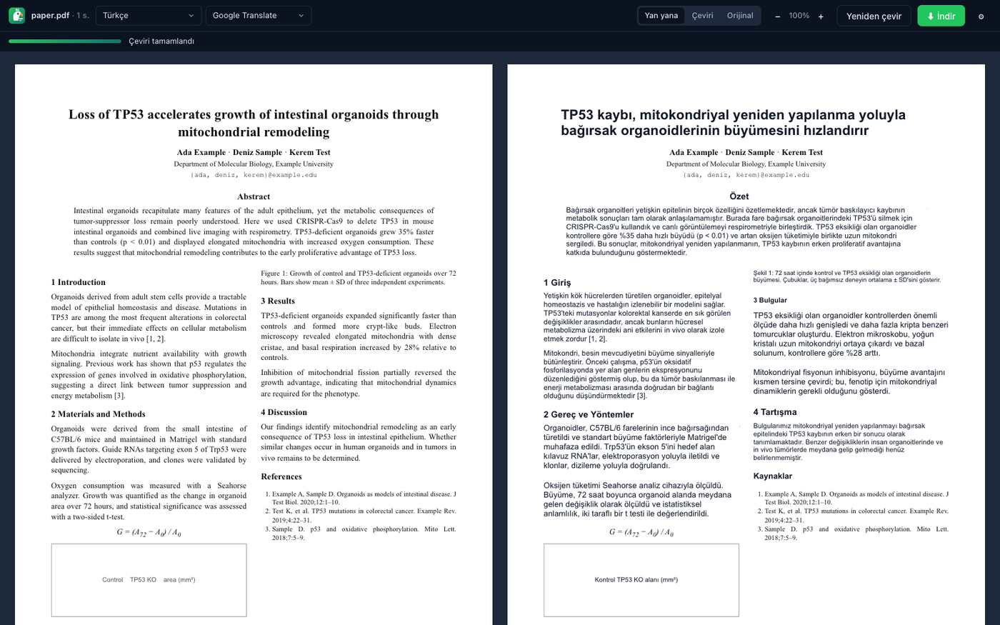
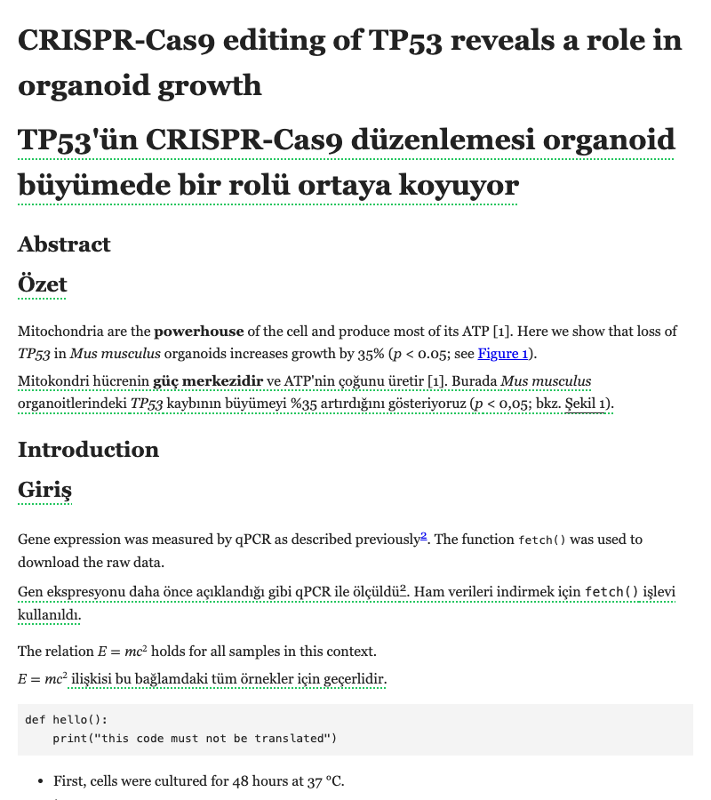
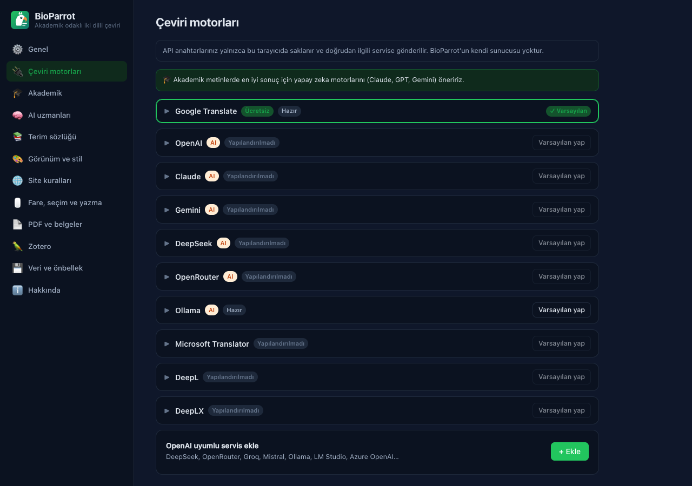

<p align="center">
  
</p>

<h1 align="center">BioParrot 🦜</h1>

<p align="center">
  <b>Akademik odaklı iki dilli çeviri</b> — web sayfaları, PDF makaleler ve Zotero için.<br />
  <i>Academic-first bilingual translation for web pages, PDF papers and Zotero.</i>
</p>

<p align="center">
  <a href="#türkçe">Türkçe</a> · <a href="#english">English</a>
</p>

<p align="center">
  
</p>

---

## Türkçe

BioParrot, okuduğunuz metnin **çevirisini orijinalin hemen altına** yerleştiren açık kaynaklı bir tarayıcı eklentisidir. Akademik okuma için tasarlandı: makalelerde terimleri doğru ve tutarlı çevirir; atıfları, formülleri, gen ve tür adlarını korur. PDF makaleleri **sayfa düzenini koruyarak** çevirir. Aynı çeviri motoru bir **Zotero eklentisi** olarak da çalışır.

> Immersive Translate'ten ilham alınmıştır; onunla herhangi bir bağlantısı yoktur.

### Özellikler

**Web sayfaları**
- İki dilli ve "yalnız çeviri" görünümleri; 13 çeviri stili (noktalı alt çizgi, vurgulama, bulanık öğrenme modu, kart…).
- Bağlantılar, kalın/italik yazı, satır içi kod, formüller (MathML/MathJax/KaTeX) ve atıf numaraları çeviride korunur.
- Yalnızca ekranda görünen paragrafları çevirir (API maliyetini düşürür); sonradan yüklenen içeriği (Twitter, Reddit vb.), iframe'leri ve gölge DOM'u izler.
- Ana içerik modu menüleri, üst ve alt bilgileri atlar; sitelere özel kurallar ve kendi CSS seçici kurallarınız.
- **Otomatik çeviri isteğe bağlıdır:** "Tüm sayfaları otomatik çevir" anahtarı, site ve dil kuralları. Varsayılan olarak yalnızca siz istediğinizde çevrilir.

**Seçim, fare ve yazma**
- **Seçim çevirisi:** Metni seçince küçük bir nokta çıkar; noktaya basınca çeviri paragrafın altına eklenir. İsterseniz açılır kart modu da kullanılabilir (kopyala, seslendir, yapay zeka ile "Açıkla", sözlüğe ekle).
- **Fareyle çeviri:** Shift (veya seçtiğiniz tuş) basılıyken farenin altındaki paragrafı çevirir.
- **Giriş kutusu çevirisi:** Yazdığınız metni üç kez boşluğa basarak İngilizceye (veya seçtiğiniz dile) çevirir. "Akademik yazım" uzmanıyla taslağınızı dergi diline çevirebilirsiniz.
- Yüzen papağan düğmesi, sağ tık menüleri ve kısayollar: Alt+A çevir, Alt+S görünümü değiştir, Alt+Z seçimi çevir.

**Akademik**
- 10 akademik "AI uzmanı": genel akademik, biyoloji ve yaşam bilimleri, tıp ve farmakoloji, kimya, fizik ve matematik, bilgisayar ve mühendislik, sosyal ve beşeri bilimler, ekonomi, hukuk, akademik yazım. Ayrıca genel, teknik, haber, sosyal medya, edebiyat ve altyazı uzmanları; kendi uzmanlarınızı da yazabilirsiniz.
- arXiv, PubMed, PMC, bioRxiv, Nature, ScienceDirect, Springer, Wiley, PLOS, MDPI, Frontiers… ve makale meta verisi olan her sayfada akademik uzman otomatik seçilir.
- **Terim tutarlılığı:** Başlık ve özetten terim listesi çıkarılır, tüm paragraflarda aynı karşılık kullanılır.
- Yerleşik karşılığı olmayan terimlerin aslı parantez içinde gösterilir; kaynakça çevrilmez; standart bölüm başlıkları ("Abstract" → "Özet", "Materials and Methods" → "Gereç ve Yöntemler") sözlükten doğru çevrilir.
- Terim sözlüğü (CSV içe/dışa aktarma) tüm motorlarda uygulanır.

**PDF çevirmeni**
- İki sütunlu düzeni, başlıkları, şekil altyazılarını, formülleri, üst/alt bilgileri ve kaynakçayı ayırt eden sayfa düzeni analizi.
- Yan yana, yalnız çeviri ve orijinal görünümleri; orijinal metin seçilebilir.
- **İki dilli PDF indirme:** yan yana, yalnız çeviri veya sıralı (orijinal + çeviri sayfası). Türkçe dahil Latin, Kiril ve Yunan alfabeleri için gömülü Noto Sans kullanılır.
- PDF bağlantılarını BioParrot'ta otomatik açma seçeneği.

**Zotero eklentisi (Zotero 7, 8 ve 9)**
- PDF okuyucuda seçtiğiniz metnin çevirisi seçim penceresinde görünür.
- Sağ tık → "Başlık ve özeti çevir" ile çeviri öğeye not olarak eklenir.
- Sağ tık → "İki dilli PDF oluştur" ile sonuç öğeye ek olarak kaydedilir.
- İsteğe bağlı olarak çeviri, vurgu yorumuna yazılır.

**Çeviri motorları**
- Google Translate (ücretsiz), Microsoft Translator (Azure), DeepL, DeepLX.
- Anthropic Claude (resmi SDK), OpenAI, Google Gemini.
- OpenAI uyumlu servisler: DeepSeek, OpenRouter, Groq, Mistral, xAI, Qwen, SiliconFlow, Together, Ollama, LM Studio, Azure OpenAI ve diğerleri.
- Motor başına hız ve toplu istek sınırları, önbellek, kullanım istatistikleri.

**Gizlilik:** BioParrot'un sunucusu yoktur. Metinler yalnızca seçtiğiniz çeviri servisine gönderilir; ayarlar ve API anahtarları tarayıcınızda kalır.

<p align="center">
  
  
</p>

### Kurulum

**Chrome / Edge / Brave:** [Sürümler](../../releases) sayfasından `bioparrot-*-chrome.zip` dosyasını indirip açın veya [kaynaktan derleyin](#geliştirme). Ardından `chrome://extensions` adresinde *Geliştirici modu*nu açın, *Paketlenmemiş öğe yükle* deyip klasörü seçin (`.output/chrome-mv3`).

**Firefox:** `about:debugging#/runtime/this-firefox` → *Geçici eklenti yükle* → `.output/firefox-mv2/manifest.json`.

**Zotero:**
1. `bioparrot-zotero-*.xpi` dosyasını indirin.
2. Zotero → *Araçlar → Eklentiler* → ⚙ → *Dosyadan Eklenti Yükle…* ile dosyayı seçin.
3. Tarayıcı eklentisinde *Ayarlar → Zotero → "Ayarları Zotero için kopyala"* deyin ve Zotero → *Ayarlar → BioParrot* bölümüne yapıştırın.

### Geliştirme

Gereksinimler: **Node.js 22+** ve npm. Uçtan uca testler için Google Chrome da gerekir.

```bash
git clone https://github.com/asametsoyl/bioparrot.git && cd bioparrot
npm install
npm run dev            # sıcak yenilemeli geliştirme (Chrome)
npm run build          # Chrome/Edge  → .output/chrome-mv3
npm run build:firefox  # Firefox      → .output/firefox-mv2
npm run build:zotero   # Zotero       → .output/bioparrot-zotero-<sürüm>.xpi
npm run zip            # mağaza paketleri
npm run compile        # TypeScript denetimi
npm test               # birim testleri
npm run test:e2e       # tarayıcıda uçtan uca test (yerel Chrome, geçici profil)
npm run test:pdf       # PDF çevirmeni testi (tests/e2e/fixtures/sample-paper.pdf)
```

> `.npmrc` dosyasındaki `bin-links=false` ayarı, projenin exFAT gibi sembolik bağlantı desteklemeyen disklerde de kurulabilmesi içindir. Bu yüzden betikler araçları doğrudan `node node_modules/...` ile çalıştırır.

**Proje yapısı**

| Klasör | İçerik |
| --- | --- |
| `src/core` | Platformdan bağımsız çekirdek: çeviri motorları, istemler, AI uzmanları, çeviri servisi (önbellek, toplu istek, yeniden deneme), terim sözlüğü, PDF düzen analizi ve dışa aktarma, arayüz metinleri (TR/EN) |
| `src/content` | Web sayfası çevirisi: paragraf ayrıştırma, yerleştirme, yüzen düğme, seçim, fare ve giriş kutusu |
| `src/entrypoints` | Eklenti giriş noktaları: arka plan, içerik betiği, popup, ayarlar, PDF sayfası |
| `src/pdf-app` | PDF çevirmeni arayüzü (eklenti ve Zotero ortak kullanır) |
| `src/ui` | Ortak React bileşenleri ve tasarım sistemi |
| `zotero/` | Zotero eklentisi (önyükleyici, okuyucu entegrasyonu, menüler, tercihler, PDF penceresi) |
| `tests/` | Birim testleri (Vitest) ve uçtan uca testler (Puppeteer) |

### Yol haritası

- [ ] Video altyazı çevirisi (YouTube, Coursera, Netflix…) ve konuşmadan yapay zeka altyazısı
- [ ] EPUB, DOCX, SRT/VTT/ASS, Markdown ve HTML belge çevirisi
- [ ] Görsel ve manga çevirisi (OCR + görsel yapay zeka modelleri)
- [ ] Çince, Japonca, Arapça hedefler için PDF dışa aktarımında ek yazı tipleri
- [ ] Safari (macOS/iOS) ve Firefox Android paketleri

Katkılarınızı bekliyoruz: [CONTRIBUTING.md](CONTRIBUTING.md).

---

## English

BioParrot is an open-source browser extension that places the **translation right below the original text**. It is built for academic reading: it translates terminology accurately and consistently, and it preserves citations, formulas, gene symbols and species names. It translates PDF papers **while keeping their layout** and also works as a **Zotero plugin**.

> Inspired by Immersive Translate; not affiliated with it.

**Highlights**
- **Web pages:** bilingual and translation-only views with 13 styles. Links, emphasis, inline code, math and citation marks survive translation. Lazy, scroll-based translation covers dynamic content, iframes and shadow DOM. Automatic page translation is optional.
- **Selection translation:** a small dot appears next to your selection; press it to insert the translation below the paragraph. A pop-up card mode adds copy, read aloud, AI explain and add-to-glossary.
- **Also:** hover translation (Shift), input-box translation (press space three times), floating button, context menus and shortcuts (Alt+A, Alt+S, Alt+Z).
- **Academic:**
  - 10 academic AI experts (biology, medicine, chemistry, physics/math, CS, social sciences, economics, law, academic writing, general).
  - The academic expert is chosen automatically on scholarly sites.
  - Terminology consistency from the title and abstract, original terms kept in parentheses, references skipped, and a section-heading dictionary.
- **PDF translator:** layout analysis that handles two-column papers, headings, captions, formulas, headers/footers and references. Download side-by-side, translation-only or interleaved bilingual PDFs.
- **Zotero plugin (7–9):**
  - Translation of selections in the PDF reader.
  - Title and abstract translation saved as notes.
  - Bilingual PDFs saved as attachments.
  - Optional translated highlight comments.
- **Services:**
  - Google (free), Microsoft Azure, DeepL, DeepLX.
  - Claude (official Anthropic SDK), OpenAI, Gemini.
  - Any OpenAI-compatible API (DeepSeek, OpenRouter, Groq, Mistral, Ollama, LM Studio, Azure OpenAI…).
- **Privacy:** there is no BioParrot server. Text goes only to the service you choose, and keys stay in your browser.

**Build:** `npm install && npm run build` (Chrome), `npm run build:firefox`, `npm run build:zotero`. Requires Node.js 22+.

---

## Lisans / License

[MIT](LICENSE). Üçüncü taraf bileşenler / third-party components: [pdf.js](https://github.com/mozilla/pdf.js) (Apache-2.0), [pdf-lib](https://github.com/Hopding/pdf-lib) (MIT), [Noto Sans / Noto Sans Math](https://fonts.google.com/noto) (SIL OFL 1.1), [React](https://react.dev) (MIT), [WXT](https://wxt.dev) (MIT), [Anthropic SDK](https://github.com/anthropics/anthropic-sdk-typescript) (MIT).
